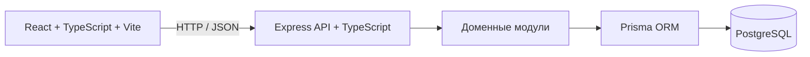

# Архитектура MotoClub

Архитектура первой версии — модульный монолит. Клиент, API и PostgreSQL запускаются как отдельные процессы/контейнеры в одной системе. Клиент обращается к серверу по HTTP; бизнес-правила и контроль доступа остаются на сервере.

## Границы серверных модулей

- `auth` — регистрация, вход, сессия и роли.
- `users` — профиль и социальные связи.
- `garage` — мотоциклы и обслуживание.
- `posts` — публикации, комментарии и лента.
- `communities` — сообщества и членство.
- `trips` и `routes` — поездки, точки маршрута и каталог.
- `places` — полезные места.
- `listings` — объявления и избранное.
- `messaging` и `notifications` — диалоги, сообщения и уведомления.
- `moderation` — жалобы и действия администратора.

Модули используют общую базу данных и не вызывают друг друга через сетевые сервисы. API документируется OpenAPI по мере появления ресурсов. Socket.IO остаётся необязательным расширением после базового HTTP API.

## Размещение

- Web-клиент: Vite dev server локально; статическая сборка для публикации.
- API: Node.js/Express.
- БД: PostgreSQL в Docker Compose для локальной разработки.
- Конфигурация: `.env`; шаблон переменных хранится в `.env.example`.
