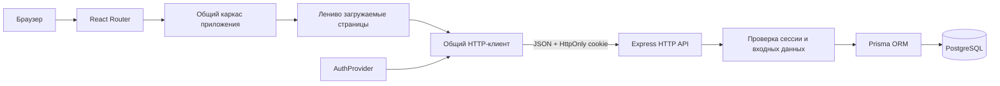

# Архитектура MotoClub

MotoClub состоит из одностраничного React-приложения, HTTP API на Express и PostgreSQL. Браузер отвечает за страницы и ввод данных. Сервер проверяет запросы, сессию и права доступа, затем читает или изменяет данные через Prisma.

## Frontend

- `src/app/` — конфигурация URL-маршрутов и общий каркас с навигацией.
- `src/pages/` — отдельные экраны: лента, поездки, клубы, объявления, карта, гараж, друзья, профиль и вход.
- `src/features/auth/` — загрузка пользователя, вход, регистрация и выход.
- `src/shared/` — HTTP-клиент, общие типы, иконка и состояния загрузки/ошибки/пустого списка.
- Страницы загружаются по требованию через `React.lazy`; при первом открытии карты Leaflet не входит в основной JS-файл.
- Данные запрашиваются при открытии соответствующего раздела. Поиск каталога объявлений и райдеров ограничен задержкой ввода, чтобы не посылать запрос на каждый символ.

## Backend

Это модульный монолит: одна Express-служба с отдельными маршрутами API по предметным областям. Бизнес-проверки находятся рядом с HTTP-маршрутами; отдельного слоя services пока нет.

- `server/src/routes/` — маршруты авторизации, здоровья сервиса и функций продукта.
- `server/src/middleware/` — проверка сессии, ролей и ошибок HTTP.
- `server/src/lib/` — хеширование паролей и подпись сессионных токенов.
- `server/prisma/schema.prisma` — сущности и отношения базы данных.
- `server/prisma/migrations/` — применяемая история изменений схемы.
- `server/prisma/seed.ts` — демонстрационные учётные записи и данные.

Авторизация хранит подписанный токен в HttpOnly cookie. Клиент не читает его из JavaScript и отправляет браузером с `credentials: include`.

## Локальный запуск

Vite обслуживает frontend на `localhost:5173`, Express — API на `localhost:3000`, PostgreSQL запускается через Docker Compose. `npm run dev:all` запускает frontend и API параллельно; базу перед этим нужно поднять отдельно.

WebSocket, чат, уведомления, модерация и сервисный слой пока не входят в реализованную часть проекта.
