# Предварительная ER-диаграмма

Модель выделяет основные сущности из технического задания. Поля и ограничения уточняются при реализации вертикальных срезов.

```mermaid
erDiagram
  USER ||--|| USER_PROFILE : has
  USER ||--o{ FRIEND_REQUEST : sends
  USER ||--o{ MOTORCYCLE : owns
  MOTORCYCLE ||--o{ MAINTENANCE_RECORD : records
  USER ||--o{ POST : writes
  POST ||--o{ COMMENT : has
  POST ||--o{ REACTION : receives
  USER ||--o{ COMMENT : writes
  USER ||--o{ REACTION : adds
  USER ||--o{ COMMUNITY_MEMBER : joins
  COMMUNITY ||--o{ COMMUNITY_MEMBER : includes
  COMMUNITY ||--o{ POST : contains
  USER ||--o{ TRIP : organizes
  TRIP ||--o{ TRIP_PARTICIPANT : includes
  USER ||--o{ TRIP_PARTICIPANT : joins
  TRIP ||--o{ TRIP_WAYPOINT : has
  USER ||--o{ ROUTE : creates
  ROUTE ||--o{ ROUTE_WAYPOINT : has
  USER ||--o{ LISTING : publishes
  LISTING ||--o{ LISTING_IMAGE : displays
  USER ||--o{ SAVED_ITEM : saves
  USER ||--o{ CONVERSATION_MEMBER : participates
  CONVERSATION ||--o{ CONVERSATION_MEMBER : includes
  CONVERSATION ||--o{ MESSAGE : contains
  USER ||--o{ MESSAGE : sends
  USER ||--o{ NOTIFICATION : receives
  USER ||--o{ REPORT : files
  USER ||--o{ MODERATION_ACTION : performs
  USER ||--o{ PLACE : suggests

  USER {
    string id PK
    string email UK
    string displayName
    datetime createdAt
  }
  USER_PROFILE {
    string userId PK,FK
    string bio
    string avatarUrl
    string privacy
  }
  MOTORCYCLE {
    string id PK
    string ownerId FK
    string make
    string model
    int year
  }
  POST {
    string id PK
    string authorId FK
    string communityId FK
    string text
    datetime createdAt
  }
  COMMUNITY {
    string id PK
    string ownerId FK
    string name
  }
  TRIP {
    string id PK
    string organizerId FK
    string title
    datetime startsAt
  }
  ROUTE {
    string id PK
    string creatorId FK
    string title
  }
  LISTING {
    string id PK
    string sellerId FK
    string category
    decimal price
  }
  CONVERSATION {
    string id PK
    datetime createdAt
  }
  MESSAGE {
    string id PK
    string conversationId FK
    string senderId FK
    string text
    datetime sentAt
  }
```

Заявки в друзья и членство в сообществах/поездках реализуются отдельными связующими сущностями. Избранное хранит тип и идентификатор сохраняемого ресурса либо будет нормализовано при уточнении схемы.
